# TAX-04 — Modelo técnico e persistência da Taxonomia TriBusca v1

**Estado:** `proposed-for-independent-review`  
**Classe:** R2 — arquitetura/persistência material  
**Data de referência:** 29/09/2026  
**Issue:** #26  
**Base documental:** TAX-01 aprovada + TAX-02 R6 aprovada no recheck TAX-03-R6  
**Base técnica observada:** `radar-fiscal-backend/main@eff26cb9ab971a757d098f360cc65d205b29030f`

> Esta especificação é **desenho técnico**, não implementação. Não contém migration SQL, não altera PostgreSQL, não carrega os 628 conceitos, não altera backend/frontend e não autoriza deploy. A R6 permanece semanticamente intacta.

---

## 1. Objetivo e limites

A TAX-04 define como a Taxonomia TriBusca v1 deve ser representada, versionada, auditada e relacionada às publicações globais e aos dados privados dos clientes.

O desenho precisa permitir que uma atividade posterior implemente migrations, tipos TypeScript, importador e APIs sem reinventar as decisões fundamentais.

Pergunta central:

> **Como representar, versionar e reproduzir a taxonomia e suas classificações sem misturar conteúdo oficial/global, inteligência global TriBusca e relevância privada de tenant?**

### 1.1 Não objetivos

Ficam fora desta atividade:

- migration SQL;
- execução PostgreSQL;
- carga dos 628 conceitos;
- regeneração de Kysely types;
- API REST;
- UI;
- filtros frontend;
- embeddings;
- pgvector;
- OpenAI API;
- classificador automático;
- matching real;
- reprocessamento histórico;
- correção dos 24 gaps `PARTIAL`;
- fechamento de G04;
- criação de `bookkeeping.mit`;
- criação de `platform.mit` ou `obligation.mit`;
- qualquer alteração semântica da TAX-02 R6.

---

## 2. Fontes, snapshots e premissas revalidadas

### 2.1 Governança e taxonomia

- `tribusca-control/main` observado no início: `a83a91bba3194218b1ac9e751be2888eba53b351`;
- R6 canônica em `docs/taxonomy/TAX-02_DICIONARIO_FUNCIONAL_TAXONOMIA_TRIBUSCA_V1_R6.md`;
- blob R6 em main: `4f3b906d5ca2044ed05b3397890a5fc45c44e8c1`;
- SHA aprovado da R6: `fee931cb212de808fa3fee1a06c833d746637c8c`;
- SHA-256 R6: `7f68d7be2dfc5486f4fb5c88259de629976b1daa54b62cf9248f4e6efbbadfd2`;
- TAX-01 permanece contrato histórico aprovado no ref congelado do PR #19.

R6 contém:

- **628** códigos canônicos;
- **628** códigos únicos;
- **55** linhas com `NEEDS_EVIDENCE`;
- **24** gaps `PARTIAL`;
- **G04 OPEN**;
- corpus **C01–C31**;
- MIT = `UNMAPPED_DIMENSION`.

### 2.2 Backend atual

A `main` do backend foi revalidada em `eff26cb9ab971a757d098f360cc65d205b29030f`.

O schema atual confirma:

| Entidade atual | Natureza | Papel relevante para TAX-04 |
|---|---|---|
| `publications` | global | identidade da publicação |
| `publication_versions` | global | conteúdo/versionamento imutavelmente identificável por `content_hash` |
| `publication_origins` | global | proveniência por fonte/URL |
| `publication_files` | global | artefatos ligados à versão |
| `monitoring_profiles` | tenant via company | critérios privados, atualmente `criteria JSONB` |
| `company_publications` | tenant via company | relação privada empresa × publicação |
| `publication_matches` | tenant via `company_publication` | histórico de matching privado |
| `company_tax_profiles` | tenant | perfil tributário privado |
| `company_cnaes` / `establishment_cnaes` | tenant | CNAEs concretos de empresa/estabelecimento |
| `cnaes` | global | catálogo operacional atual, sem versionamento de edição |

O backend já separa:

```text
publication             = identidade global
publication_version     = conteúdo global versionado
company_publication     = relação privada empresa × publication
publication_match       = evidência/histórico privado do matching
```

A TAX-04 **não duplica** essas entidades.

### 2.3 Segurança e papéis atuais

- `radar_app_runtime` herda apenas `radar_app`;
- `radar_worker_runtime` herda apenas `radar_worker`;
- ambos são `NOSUPERUSER`, `NOBYPASSRLS`;
- tabelas tenant-scoped relevantes têm RLS + `FORCE ROW LEVEL SECURITY`;
- `radar_app` lê publicações globais, mas não as escreve;
- `radar_worker` coleta e escreve o acervo global;
- `radar_app` não pode acessar `schema_migrations`;
- o Worker não lê credenciais/sessões de autenticação.

A TAX-04 não relaxa nenhuma dessas proteções.

---

## 3. Princípios arquiteturais

### P1 — três camadas permanecem separadas

1. **Conteúdo oficial/global:** publicação, versão, origem, arquivo, taxonomia, catálogo oficial, evidência.
2. **Inteligência global TriBusca:** classificação tributária de uma `publication_version`, candidatos semânticos, relações conceituais.
3. **Relevância privada:** perfil, estabelecimento, CNAE concreto, benefício do cliente, uso de SAP/J1BTAX/DRC, `company_publication`, `publication_match`.

A camada 3 nunca é promovida para 1 ou 2.

### P2 — identidade não é versão

Um conceito possui ID interno permanente. Seu rótulo, definição e metadados vivem em revisões imutáveis.

### P3 — release é snapshot reproduzível

Cada release aponta para a revisão exata de cada dimensão/conceito/alias/relação que compõe aquele snapshot.

### P4 — nenhuma atualização histórica silenciosa

Mudança de taxonomia, publicação ou método de classificação cria nova revisão/run/assertion. Histórico não é sobrescrito.

### P5 — código canônico não é chave física

`tax.icms` é código público estável; FKs internas usam UUID.

### P6 — catálogo oficial é externo à identidade TriBusca

NCM, CNAE, município, modelos oficiais e outros códigos não viram automaticamente conceitos TriBusca.

### P7 — evidência é objeto auditável

A existência do conceito e a suficiência de sua evidência são estados distintos.

### P8 — classificação global é por versão de conteúdo e por release

Nunca classificar apenas `publication_id` sem `publication_version_id`; nunca classificar sem `taxonomy_release_id`.

### P9 — IA não governa o vocabulário

IA/extrator pode gerar ocorrência, proposta ou classificação automática; aprovação de conceito/alias/relação continua humana/governada.

### P10 — ausência de conceito não autoriza invenção de dimensão

MIT permanece `UNMAPPED_DIMENSION`. Nenhuma tabela, enum ou importador deve materializar `bookkeeping.mit`, `platform.mit` ou `obligation.mit`.

---

## 4. Decisões arquiteturais resumidas

| ID | Decisão |
|---|---|
| T04-D01 | Usar **identidade permanente + revisões imutáveis + associação conceito/revisão à release**. |
| T04-D02 | Release TriBusca usa `vMAJOR.MINOR.PATCH`; versão de catálogo oficial é independente. |
| T04-D03 | Código canônico é globalmente único e nunca reutilizado, mesmo após descontinuação. |
| T04-D04 | Dimensão possui identidade própria e contrato versionado; runtime não deduz dimensão apenas pelo prefixo. |
| T04-D05 | Alias é identidade lexical separada; vínculo alias→conceito é release-scoped e tipado. |
| T04-D06 | Relações conceito→conceito são release-scoped, dirigidas, tipadas e sem propagação automática. |
| T04-D07 | `maps_to_official` é implementado fisicamente por tabela especializada de correspondência com catálogo, não por FK para conceito. |
| T04-D08 | Evidências são normalizadas e ligadas por FKs específicas, evitando uma tabela polimórfica sem integridade referencial. |
| T04-D09 | Classificação global usa **run imutável + assertions + spans + reviews append-only**. |
| T04-D10 | Reclassificação sempre cria novo run; `supersedes_run_id` documenta linhagem. |
| T04-D11 | UNMAPPED separa **ocorrência extraída** de **candidato semântico agrupado**. |
| T04-D12 | Taxonomia e classificação global não têm `tenant_id`; matching privado existente continua RLS-scoped. |
| T04-D13 | Escrita da taxonomia canônica não é concedida a `radar_app` nem ao Worker de coleta; haverá caminho de curadoria/importação restrito em atividade posterior. |
| T04-D14 | `monitoring_profiles.criteria` não muda nesta atividade; futura integração começa por contrato versionado, não por migration prematura. |
| T04-D15 | Importação da R6 deve falhar se não reproduzir exatamente 628 conceitos e 55 `NEEDS_EVIDENCE`, salvo mudança documental aprovada e explicitamente justificada. |

---

## 5. Modelo lógico

### 5.1 Entidades propostas

**Release e metamodelo**
- `taxonomy_releases`
- `taxonomy_dimensions`
- `taxonomy_dimension_revisions`
- `taxonomy_release_dimensions`
- `taxonomy_relation_types`
- `taxonomy_release_relation_rules`

**Conceitos**
- `taxonomy_concepts`
- `taxonomy_concept_revisions`
- `taxonomy_release_concepts`

**Aliases e relações**
- `taxonomy_aliases`
- `taxonomy_release_alias_bindings`
- `taxonomy_concept_relations`

**Evidência**
- `taxonomy_evidence`
- `taxonomy_concept_revision_evidence`
- `taxonomy_alias_binding_evidence`
- `taxonomy_relation_evidence`
- `taxonomy_official_mapping_evidence`

**Catálogos oficiais**
- `official_catalogs`
- `official_catalog_editions`
- `official_catalog_entries`
- `taxonomy_official_mappings`

**Classificação global**
- `publication_taxonomy_runs`
- `publication_taxonomy_assertions`
- `publication_taxonomy_spans`
- `publication_taxonomy_reviews`

**UNMAPPED/candidatos**
- `taxonomy_unmapped_occurrences`
- `taxonomy_candidates`
- `taxonomy_candidate_occurrence_links`

**Auditoria de governança**
- `taxonomy_governance_events`

### 5.2 Diagrama ER

```mermaid
erDiagram
    TAXONOMY_RELEASES ||--o{ TAXONOMY_RELEASE_DIMENSIONS : contains
    TAXONOMY_DIMENSIONS ||--o{ TAXONOMY_DIMENSION_REVISIONS : has
    TAXONOMY_DIMENSION_REVISIONS ||--o{ TAXONOMY_RELEASE_DIMENSIONS : selected_in

    TAXONOMY_DIMENSIONS ||--o{ TAXONOMY_CONCEPTS : classifies
    TAXONOMY_CONCEPTS ||--o{ TAXONOMY_CONCEPT_REVISIONS : has
    TAXONOMY_RELEASES ||--o{ TAXONOMY_RELEASE_CONCEPTS : snapshots
    TAXONOMY_CONCEPTS ||--o{ TAXONOMY_RELEASE_CONCEPTS : included_as
    TAXONOMY_CONCEPT_REVISIONS ||--o{ TAXONOMY_RELEASE_CONCEPTS : selected_revision

    TAXONOMY_ALIASES ||--o{ TAXONOMY_RELEASE_ALIAS_BINDINGS : lexical_form
    TAXONOMY_RELEASES ||--o{ TAXONOMY_RELEASE_ALIAS_BINDINGS : scopes
    TAXONOMY_RELEASE_CONCEPTS ||--o{ TAXONOMY_RELEASE_ALIAS_BINDINGS : targets

    TAXONOMY_RELEASE_CONCEPTS ||--o{ TAXONOMY_CONCEPT_RELATIONS : source
    TAXONOMY_RELEASE_CONCEPTS ||--o{ TAXONOMY_CONCEPT_RELATIONS : target
    TAXONOMY_RELATION_TYPES ||--o{ TAXONOMY_CONCEPT_RELATIONS : types

    OFFICIAL_CATALOGS ||--o{ OFFICIAL_CATALOG_EDITIONS : versions
    OFFICIAL_CATALOG_EDITIONS ||--o{ OFFICIAL_CATALOG_ENTRIES : contains
    TAXONOMY_RELEASE_CONCEPTS ||--o{ TAXONOMY_OFFICIAL_MAPPINGS : maps
    OFFICIAL_CATALOG_ENTRIES ||--o{ TAXONOMY_OFFICIAL_MAPPINGS : mapped_to

    TAXONOMY_EVIDENCE ||--o{ TAXONOMY_CONCEPT_REVISION_EVIDENCE : supports
    TAXONOMY_CONCEPT_REVISIONS ||--o{ TAXONOMY_CONCEPT_REVISION_EVIDENCE : evidenced_by
    TAXONOMY_EVIDENCE ||--o{ TAXONOMY_ALIAS_BINDING_EVIDENCE : supports
    TAXONOMY_EVIDENCE ||--o{ TAXONOMY_RELATION_EVIDENCE : supports
    TAXONOMY_EVIDENCE ||--o{ TAXONOMY_OFFICIAL_MAPPING_EVIDENCE : supports

    PUBLICATION_VERSIONS ||--o{ PUBLICATION_TAXONOMY_RUNS : classified_as
    TAXONOMY_RELEASES ||--o{ PUBLICATION_TAXONOMY_RUNS : uses
    PUBLICATION_TAXONOMY_RUNS ||--o{ PUBLICATION_TAXONOMY_ASSERTIONS : emits
    TAXONOMY_RELEASE_CONCEPTS ||--o{ PUBLICATION_TAXONOMY_ASSERTIONS : identifies
    PUBLICATION_TAXONOMY_ASSERTIONS ||--o{ PUBLICATION_TAXONOMY_SPANS : evidenced_by
    PUBLICATION_TAXONOMY_ASSERTIONS ||--o{ PUBLICATION_TAXONOMY_REVIEWS : reviewed_by

    PUBLICATION_TAXONOMY_RUNS ||--o{ TAXONOMY_UNMAPPED_OCCURRENCES : extracts
    TAXONOMY_CANDIDATES ||--o{ TAXONOMY_CANDIDATE_OCCURRENCE_LINKS : groups
    TAXONOMY_UNMAPPED_OCCURRENCES ||--o{ TAXONOMY_CANDIDATE_OCCURRENCE_LINKS : linked
```



---

## 6. Release da taxonomia

### 6.1 `taxonomy_releases`

Campos lógicos:

| Campo | Tipo lógico | Regra |
|---|---|---|
| `id` | UUID | identidade imutável |
| `version_major/minor/patch` | inteiro | >= 0 |
| `version` | texto derivável | `vMAJOR.MINOR.PATCH`, único |
| `status` | enum | `DRAFT`, `IN_REVIEW`, `APPROVED`, `PUBLISHED`, `WITHDRAWN` |
| `previous_release_id` | UUID nullable | release predecessora |
| `created_at` | timestamptz | obrigatório |
| `approved_at` | timestamptz nullable | obrigatório a partir de APPROVED |
| `published_at` | timestamptz nullable | obrigatório em PUBLISHED |
| `artifact_repository` | texto | ex. `tribusca-control` |
| `artifact_path` | texto | caminho documental |
| `artifact_git_sha` | char(40) | SHA do artefato aprovado |
| `artifact_sha256` | char(64) | integridade da entrada |
| `manifest` | JSONB | contagens, dimensões, hashes e decisões da carga |
| `change_notes` | texto | delta humano |
| `created_by_actor` | texto/UUID | trilha de governança |

### 6.2 Semântica de versão

Conforme TAX-01:

- **MAJOR:** mudança incompatível de significado, relação ou regra de inferência;
- **MINOR:** conceito/alias novo compatível;
- **PATCH:** metadado/grafia sem mudança semântica.

Versão de NCM/CNAE/MOC/ato oficial **não** altera automaticamente a versão da taxonomia.

### 6.3 Imutabilidade

Após `PUBLISHED`:

- conteúdo lógico da release é read-only;
- correção cria nova release;
- retirada usa `WITHDRAWN`, sem DELETE;
- associação release→revision não pode ser regravada silenciosamente.

### 6.4 Baseline R6

A futura carga inicial deverá propor uma release `v1.0.0` baseada na R6, mas a criação efetiva dessa release pertence à atividade de implementação/importação, não à TAX-04.

---

## 7. Dimensões

### 7.1 Por que dimensão é entidade

O prefixo do código continua útil para validação humana, mas o runtime não deve assumir que `split('.') [0]` é o contrato de dimensão.

Um conceito referencia `dimension_id` explicitamente.

### 7.2 Entidades

`taxonomy_dimensions`:

- `id` UUID;
- `code` imutável e único;
- `identity_status`: `CURRENT`, `DEPRECATED`, `RETIRED`;
- timestamps.

`taxonomy_dimension_revisions`:

- `id`;
- `dimension_id`;
- `revision_no`;
- `name`;
- `description`;
- `governance_status`;
- `constraints` JSONB;
- `created_at`.

`taxonomy_release_dimensions`:

- `release_id`;
- `dimension_id`;
- `dimension_revision_id`;
- `membership_status`.

### 7.3 Baseline R6 — dimensões e contagens

| Dimensão | Qtd. |
|---|---:|
| `tax_species` | 5 |
| `tax` | 43 |
| `theme` | 44 |
| `treatment` | 12 |
| `regime` | 19 |
| `operation` | 150 |
| `operation_scope` | 3 |
| `operation_purpose` | 10 |
| `operation_channel` | 3 |
| `document` | 12 |
| `platform` | 2 |
| `obligation` | 22 |
| `sector` | 45 |
| `product` | 188 |
| `sphere` | 4 |
| `subject` | 26 |
| `event` | 13 |
| `act_type` | 8 |
| `impact_operational` | 10 |
| `impact_system` | 9 |
| **Total** | **628** |

A dimensão `platform` existe no baseline R6 com dois conceitos, mas **não é categoria residual**. MIT não pertence a ela.

Nenhuma dimensão `bookkeeping` é criada nesta especificação.

---

## 8. Identidade e versionamento dos conceitos

### 8.1 `taxonomy_concepts` — identidade permanente

Campos:

- `id UUID PK`;
- `code TEXT UNIQUE NOT NULL`;
- `dimension_id UUID NOT NULL`;
- `identity_status`: `CURRENT`, `DEPRECATED`, `RETIRED`;
- `created_at`;
- `retired_at nullable`.

Regras:

1. `code` nunca é PK física;
2. `code` é imutável depois de criado;
3. código retirado continua reservado;
4. renomear rótulo não altera `code`;
5. mudança incompatível de significado requer novo conceito e `replaced_by`, não reutilização de código.

Formato técnico recomendado:

```text
^[a-z][a-z0-9_]*(\.[a-z0-9_]+)+$
```

### 8.2 `taxonomy_concept_revisions`

Cada revisão é imutável:

- `id`;
- `concept_id`;
- `revision_no`;
- `label`;
- `definition`;
- `positive_example`/metadados de exemplo;
- `negative_example`/metadados de contraexemplo;
- `governance_status`;
- `evidence_status`;
- `notes`;
- `source_metadata JSONB`;
- `created_at`.

Unique: `(concept_id, revision_no)`.

### 8.3 `taxonomy_release_concepts`

Snapshot por release:

- `id`;
- `release_id`;
- `concept_id`;
- `concept_revision_id`;
- `membership_status`: `INCLUDED`, `DEPRECATED`, `RETIRED`;
- `classification_enabled BOOLEAN`;
- `release_notes`.

Unique: `(release_id, concept_id)`.

A implementação deve usar FK composta ou validação equivalente para garantir que `concept_revision_id` pertence ao mesmo `concept_id`.

### 8.4 Status dos 628 da R6

A TAX-04 **não reinterpreta** o status semântico da R6.

Recomendação de carga inicial:

- identidade: `CURRENT`;
- associação à release: `INCLUDED`;
- `governance_status`: preservar `PROPOSED` da R6;
- `classification_enabled`: true **somente porque a release baseline foi aprovada como vocabulário operacional**, não porque exista alegação de completude jurídica;
- `evidence_status`: mapeado separadamente.

Isto permite afirmar simultaneamente:

> “o conceito está incluído no baseline publicado”

sem afirmar:

> “o conceito está juridicamente completo/definitivo”.

### 8.5 Evidência dos conceitos

`evidence_status` recomendado:

- `DOCUMENTED`: há evidência/justificativa registrada, sem afirmar completude jurídica;
- `NEEDS_EVIDENCE`: R6 exige evidência adicional;
- `NOT_ASSESSED`: reservado para conceitos futuros ainda não avaliados.

Na importação R6:

- as **55** linhas explicitamente `NEEDS_EVIDENCE` devem continuar assim;
- demais conceitos podem ser `DOCUMENTED`, inclusive quando a base é TriBusca ou híbrida;
- `DOCUMENTED` não significa “fonte oficial suficiente para toda aplicação concreta”.

---

## 9. Alternativa de versionamento — decisão

### Alternativa A — identidade + revisões + release membership **(recomendada)**

Vantagens:

- revision imutável;
- revisão pode ser reutilizada por releases consecutivas;
- histórico exato;
- ID do conceito nunca muda;
- release é snapshot explícito;
- `replaced_by` preserva linhagem.

Custo:

- mais joins;
- importador precisa montar snapshot.

### Alternativa B — duplicar todos os conceitos por release

Vantagens:

- query histórica simples.

Desvantagens:

- identidade fica ambígua;
- 628 linhas são duplicadas mesmo sem alteração;
- FKs históricas precisam decidir se apontam para “conceito lógico” ou “cópia da release”;
- maior risco de divergência de código.

### Alternativa C — uma linha mutável com `valid_from/valid_to`

Rejeitada porque:

- incentiva UPDATE histórico;
- reproduzir release depende de intervalos e ordem de operações;
- dificulta provar qual definição foi usada em uma classificação.

**Decisão:** A.

---

## 10. Aliases

### 10.1 Separação lexical

`taxonomy_aliases` representa apenas forma lexical:

- `id`;
- `text`;
- `normalized_text`;
- `language`;
- timestamps.

Não possui `concept_id`.

### 10.2 Binding por release

`taxonomy_release_alias_bindings`:

- `id`;
- `release_id`;
- `alias_id`;
- `release_concept_id`;
- `alias_type`;
- `decision_status`: `APPROVED`, `REJECTED`, `DEPRECATED`;
- `jurisdiction_level/uf/municipality_code` quando aplicável;
- `context JSONB`;
- `valid_from/valid_to`;
- `justification`;
- `evidence_status`;
- timestamps.

Tipos TAX-01 obrigatórios:

- `EXACT_LEXICAL`;
- `ABBREVIATION`;
- `HISTORICAL_LABEL`;
- `SEARCH_RELATED`;
- `AMBIGUOUS`.

### 10.3 Regra de automação

Somente:

- `EXACT_LEXICAL`;
- `ABBREVIATION`;
- `HISTORICAL_LABEL`;

podem participar de mapeamento automático **e somente** se contexto/jurisdição/período resultarem em um único binding elegível.

`SEARCH_RELATED` e `AMBIGUOUS` nunca produzem conceito automaticamente.

A mesma forma lexical pode ter múltiplos bindings. Portanto, não existe unique global `normalized_text → concept`.

---

## 11. Relações entre conceitos

### 11.1 Catálogo de tipos

`taxonomy_relation_types`:

- `id`;
- `code`;
- `inverse_code` nullable;
- `directed`;
- `acyclic`;
- `hierarchical`;
- `canonical_storage_code`;
- `description`.

Tipos mínimos:

- `narrower_than`;
- `broader_than`;
- `part_of`;
- `related_to`;
- `replaced_by`;
- `supersedes`;
- `applies_to`.

`maps_to_official` existe semanticamente, mas sua persistência física fica em `taxonomy_official_mappings`.

### 11.2 Regras de compatibilidade

`taxonomy_release_relation_rules`:

- `release_id`;
- `relation_type_id`;
- `source_dimension_id`;
- `target_dimension_id`;
- `allowed`;
- `requires_evidence`;
- `acyclic_override` nullable;
- `notes`.

Assim, compatibilidade não fica hard-coded apenas no TypeScript.

### 11.3 Relação concreta

`taxonomy_concept_relations`:

- `id`;
- `release_id`;
- `source_release_concept_id`;
- `target_release_concept_id`;
- `relation_type_id`;
- `status`;
- `valid_from/valid_to`;
- `qualifiers JSONB`;
- `justification`;
- `evidence_status`;
- timestamps.

### 11.4 Direção e inversas

Recomendação física:

- armazenar uma direção canônica;
- `broader_than` é inversa projetável de `narrower_than`;
- `supersedes` é inversa projetável de `replaced_by`;
- não armazenar automaticamente duas linhas espelhadas.

Isso reduz drift e contradições.

### 11.5 Ciclos

Obrigatório validar grafo no importador antes de publicar a release.

No baseline:

- `narrower_than` / `broader_than`: ciclo proibido;
- `replaced_by` / `supersedes`: ciclo proibido;
- `part_of`: ciclo proibido por padrão;
- `related_to`: ciclo permitido;
- `applies_to`: não é hierarquia e não gera herança.

Nenhuma relação implica propagação automática de classificação.

---

## 12. Evidências e auditabilidade

### 12.1 Alternativas

**A. JSONB dentro do conceito.** Simples, mas fraco para reuso, auditoria e FK.

**B. Evidência normalizada + tabelas de ligação específicas.** Mais tabelas, porém preserva integridade e reutilização.

**Decisão:** B.

### 12.2 `taxonomy_evidence`

Campos:

| Campo | Semântica |
|---|---|
| `id` | UUID |
| `basis_type` | `OFFICIAL`, `TRIBUSCA`, `HYBRID` |
| `maintainer` | órgão/mantenedor |
| `jurisdiction_level` | federal/estadual/municipal/nacional/outro |
| `uf` | quando aplicável |
| `municipality_ibge_code` | quando aplicável |
| `document_title` | norma/manual/ato |
| `act_type` / `act_number` | quando aplicável |
| `edition` | versão/edição |
| `published_on` | data do documento |
| `consulted_at` | data da consulta |
| `valid_from/valid_to` | validade conhecida |
| `official_url` | URL reproduzível |
| `locator` | artigo, item, página, campo, seção |
| `excerpt` | trecho mínimo quando permitido/necessário |
| `artifact_sha256` | hash do arquivo quando houver |
| `interpretation_note` | interpretação TriBusca quando híbrida |
| `metadata` | dados adicionais |

### 12.3 Ligações com FK real

Evitar `target_type + target_id` sem FK.

Usar:

- `taxonomy_concept_revision_evidence`;
- `taxonomy_alias_binding_evidence`;
- `taxonomy_relation_evidence`;
- `taxonomy_official_mapping_evidence`.

Cada tabela contém pelo menos:

- FK do alvo;
- `evidence_id`;
- `role`: `PRIMARY`, `SUPPORTING`, `LIMITATION`, `COUNTEREXAMPLE`;
- observação.

### 12.4 NEEDS_EVIDENCE

`NEEDS_EVIDENCE` é atributo explícito da revisão/binding/relação, não ausência implícita de linha de evidência.

Assim:

- conceito pode existir;
- pode participar do baseline;
- pode até ser classificado lexicalmente com cautela;
- continua visivelmente pendente de sustentação adicional.

O importador deve comparar a contagem esperada de **55**.

---

## 13. Catálogos oficiais

### 13.1 Entidades

`official_catalogs`:

- `id`;
- `code`: ex. `NCM`, `CNAE`, `IBGE_MUNICIPALITY`;
- `name`;
- `maintainer`;
- `description`.

`official_catalog_editions`:

- `id`;
- `catalog_id`;
- `edition_code`;
- `published_on`;
- `valid_from/valid_to`;
- `source_url`;
- `source_sha256`;
- `status`.

`official_catalog_entries`:

- `id`;
- `catalog_edition_id`;
- `official_code`;
- `description`;
- `parent_entry_id` nullable;
- `metadata`.

Unique: `(catalog_edition_id, official_code)`.

### 13.2 Correspondência TriBusca

`taxonomy_official_mappings`:

- `id`;
- `release_concept_id`;
- `official_catalog_entry_id`;
- `mapping_type`: `EXACT`, `BROADER`, `NARROWER`, `OVERLAP`;
- `valid_from/valid_to`;
- `justification`;
- `evidence_status`;
- timestamps.

### 13.3 CNAE atual do backend

A tabela `cnaes(code, description, is_active)` atual:

- continua operacional até atividade específica;
- não deve ser tratada como histórico completo de edições;
- não será alterada na TAX-04;
- futura implementação deve decidir migração/compatibilidade para o catálogo versionado.

`company_cnaes` e `establishment_cnaes` continuam privados/tenant-scoped.

### 13.4 Regra fundamental

`product.soy` pode existir sem NCM exato.

“soja” não gera NCM de oito dígitos.

“frigorífico” não vira CNAE único.

---

## 14. Classificação global de publicação

### 14.1 Unidade classificável

A unidade é:

```text
publication_version + taxonomy_release + método/versionamento de execução
```

Nunca apenas `publication`.

### 14.2 `publication_taxonomy_runs`

Campos:

- `id`;
- `publication_version_id`;
- `taxonomy_release_id`;
- `method_type`: `RULE`, `EXTRACTOR`, `MODEL`, `HUMAN`, `HYBRID`;
- `engine_key`;
- `engine_version`;
- `model_key/model_version` nullable;
- `code_git_sha` nullable;
- `config_sha256`;
- `input_sha256`;
- `status`: `PENDING`, `RUNNING`, `SUCCESS`, `PARTIAL`, `FAILED`, `CANCELLED`;
- `started_at/finished_at`;
- `supersedes_run_id` nullable;
- `metadata JSONB`;
- `created_at`.

`input_sha256` deve representar o input efetivamente classificado e configuração relevante, não substituir o `content_hash` da publicação.

### 14.3 Idempotência do run

Chave lógica recomendada:

```text
publication_version_id
+ taxonomy_release_id
+ engine_key
+ engine_version
+ config_sha256
+ input_sha256
```

Repetir exatamente o mesmo trabalho deve retornar/reconhecer o mesmo run, não duplicar resultado.

### 14.4 `publication_taxonomy_assertions`

Uma linha agregada por conceito identificado no run:

- `id`;
- `run_id`;
- `release_concept_id`;
- `assertion_status`: `PROPOSED`, `CONFIRMED`, `REJECTED`, `SUPERSEDED`;
- `confidence` nullable, 0..1;
- `decision_origin`;
- `reason_code`;
- `created_at`.

Unique recomendado: `(run_id, release_concept_id)`.

### 14.5 Evidência textual

`publication_taxonomy_spans`:

- `id`;
- `assertion_id`;
- `span_start/span_end` nullable;
- `excerpt`;
- `selector JSONB` para HTML/XML/campo estruturado;
- `source_fragment_hash` nullable;
- `created_at`.

Um conceito pode ter vários spans no mesmo texto.

### 14.6 Revisão humana

`publication_taxonomy_reviews` é append-only:

- `id`;
- `assertion_id`;
- `decision`: `CONFIRM`, `REJECT`;
- `reviewer_actor_id`;
- `rationale`;
- `created_at`.

Se o humano quiser trocar o conceito por outro, não editar a assertion original: criar novo run `HUMAN`/nova assertion e relacionar via `supersedes_run_id`.

### 14.7 Alternativa descartada

Uma única tabela mutável:

```publication_version_id + concept_id + current=true```

foi rejeitada porque perde o método/release anterior ao reclassificar.

---

## 15. Reclassificação e replay

### 15.1 Nova versão da publicação

Nova `publication_version` → novo `publication_taxonomy_run`.

A classificação da versão anterior permanece.

### 15.2 Nova release da taxonomia

Mesmo conteúdo pode ser reexecutado contra nova release.

Resultado novo aponta para novo `taxonomy_release_id`.

### 15.3 Conceito/alias/relação corrigido

Correção só entra por nova release.

Não reescrever resultados vinculados à release antiga.

### 15.4 Método alterado

Novo `engine_version`, `config_sha256` ou modelo → novo run.

### 15.5 “Atual” é derivado

A visão de “classificação atual” deve ser uma query/view baseada em política:

- versão atual da publicação;
- release publicada selecionada;
- run elegível mais recente/aceito.

Não persistir essa visão sobrescrevendo história.

---

## 16. UNMAPPED e candidatos

### 16.1 Alternativas

**A. Uma tabela de termos não mapeados com contador.** Simples, mas mistura menção e conceito e colapsa homônimos.

**B. Ocorrências imutáveis + candidatos semânticos agrupados.** Preserva contexto e permite split.

**Decisão:** B.

### 16.2 `taxonomy_unmapped_occurrences`

Cada ocorrência extraída:

- `id`;
- `run_id`;
- `publication_version_id` ou derivável do run;
- `raw_term`;
- `normalized_term`;
- `language`;
- `probable_dimension_id` nullable;
- `context_excerpt`;
- `span_start/span_end`;
- `jurisdiction metadata`;
- `extractor_key/version`;
- `confidence` nullable;
- `observed_at`;
- `metadata`.

É global somente quando vem de conteúdo oficial/global elegível.

### 16.3 `taxonomy_candidates`

Candidato semântico:

- `id`;
- `preferred_term`;
- `normalized_key`;
- `probable_dimension_id`;
- `context_signature`;
- `jurisdiction_scope`;
- `status`;
- `first_seen_at/last_seen_at`;
- `decision_actor_id` nullable;
- `decision_at` nullable;
- `decision_reason`;
- `resolved_concept_id` nullable;
- `resolved_release_id` nullable;
- `parent_candidate_id` nullable para split;
- timestamps.

Estados TAX-01:

- `NEW`;
- `NEEDS_EVIDENCE`;
- `UNDER_REVIEW`;
- `MAPPED_TO_EXISTING`;
- `APPROVED_ALIAS`;
- `APPROVED_NEW_CONCEPT`;
- `REJECTED`;
- `SPLIT_REQUIRED`.

### 16.4 Ocorrência × candidato

`taxonomy_candidate_occurrence_links`:

- `candidate_id`;
- `occurrence_id`;
- `link_status`: `ACTIVE`, `SUPERSEDED`;
- `linked_at`;
- `superseded_at`;
- justificativa.

Isso permite reagrupar sem apagar a decisão anterior.

### 16.5 Gate humano

Estados terminais:

- `MAPPED_TO_EXISTING`;
- `APPROVED_ALIAS`;
- `APPROVED_NEW_CONCEPT`;
- `REJECTED`;

exigem ator humano/curador e justificativa.

IA pode sugerir, agrupar e priorizar; não pode preencher diretamente um estado terminal.

### 16.6 MIT — caso negativo obrigatório

MIT deve aparecer apenas como ocorrência/candidato `UNMAPPED_DIMENSION` enquanto não existir decisão formal de nova dimensão.

O importador/validator deve rejeitar:

- `platform.mit`;
- `obligation.mit`;
- `bookkeeping.mit`.

---

## 17. Global × tenant e RLS

### 17.1 Matriz de escopo e permissão

Legenda:

- **R:** leitura;
- **I:** insert;
- **U:** update;
- **—:** sem privilégio por padrão.

| Entidade | Escopo | `tenant_id`? | RLS? | `radar_app` | `radar_worker` | Escrita governada |
|---|---|---:|---:|---|---|---|
| taxonomy_releases | global | não | não por tenant | R | R | curador/importador |
| taxonomy_dimensions/revisions | global | não | não | R | R | curador/importador |
| taxonomy_concepts/revisions | global | não | não | R | R | curador/importador |
| taxonomy_release_concepts | global | não | não | R | R | curador/importador |
| taxonomy_aliases/bindings | global | não | não | R | R | curador/importador |
| taxonomy_concept_relations | global | não | não | R | R | curador/importador |
| taxonomy_evidence + links | global | não | não | R | R | curador/importador |
| official_catalog* | global | não | não | R | R | importador de catálogo |
| taxonomy_official_mappings | global | não | não | R | R | curador/importador |
| publication_taxonomy_runs | global | não | não | R | R/I/U de lifecycle | classificador Worker futuro |
| publication_taxonomy_assertions/spans | global | não | não | R | R/I | classificador Worker futuro |
| publication_taxonomy_reviews | global | não | não | R | — | curador global |
| taxonomy_unmapped_occurrences | global | não | não | R | R/I | extrator Worker futuro |
| taxonomy_candidates/links | global | não | não | R | R/I limitado | curador para decisões |
| monitoring_profiles | privado | indireto via company | **sim** | R/I/U conforme RLS atual | R | tenant |
| company_publications | privado | indireto via company | **sim** | R/I/U conforme RLS atual | R/I/U conforme RLS | tenant |
| publication_matches | privado | indireto | **sim** | R/I conforme RLS atual | R/I conforme RLS | tenant |
| company_tax_profiles | privado | indireto | **sim** | R/I/U | R | tenant |
| company_cnaes/establishment_cnaes | privado | indireto | **sim** | R/I/U/D | R | tenant |

### 17.2 Por que globais não têm RLS de tenant

A ausência de `tenant_id` em taxonomia/classificação global é deliberada.

Isolamento vem de:

- ausência de dados privados;
- privilégios mínimos;
- caminho de curadoria separado;
- não expor conteúdo integral automaticamente em API pública.

RLS não deve ser usado para simular ownership de tenant sobre fatos globais.

### 17.3 Curadoria global

`radar_app` representa aplicação tenant-facing; não deve ganhar permissão de alterar vocabulário global apenas porque um usuário é OWNER/ADMIN de tenant.

Implementação posterior deve escolher entre:

- role PostgreSQL dedicada `radar_taxonomy_curator`; ou
- serviço administrativo usando credencial/admin controlada.

Essa decisão não é executada na TAX-04.

### 17.4 D-057 / conteúdo privado por CNPJ

Se futuramente existir publicação não fiscal preservada apenas por CNPJ privado, ela **não** pode alimentar as tabelas globais desta seção antes de existir isolamento de persistência/consulta aprovado.

A classificação global definida aqui pressupõe `publication_version` de conteúdo globalmente elegível.

---

## 18. Integração futura com matching

### 18.1 O que não muda agora

`monitoring_profiles.criteria JSONB` permanece como está.

`publication_matches` permanece como histórico privado.

### 18.2 Contrato futuro sugerido

Em versão futura do schema de critérios, um perfil poderá expressar algo equivalente a:

```json
{
  "taxonomy": {
    "releasePolicy": "CURRENT_PUBLISHED",
    "anyOf": ["tax.icms", "theme.presumed_credit"],
    "allOf": [],
    "noneOf": [],
    "includeDescendants": false
  }
}
```

Isso é **contrato conceitual**, não payload aprovado de API nesta atividade.

### 18.3 Por que usar código no critério

Critério de usuário/configuração pode usar código público estável.

O engine resolve:

```text
code -> concept_id -> release_concept_id
```

para a release selecionada.

Persistência interna de classificação continua por UUID.

### 18.4 replaced_by

Perfil antigo não segue `replaced_by` automaticamente.

Comportamentos possíveis a decidir em implementação:

- bloquear/avisar perfil com conceito retirado;
- oferecer migração explícita;
- permitir política opt-in de sucessão.

Nunca migrar silenciosamente filtro do cliente.

### 18.5 Evidência do match privado

Quando matching usar taxonomia, `publication_matches.matched_fields` poderá registrar temporariamente, sem migration:

- `publicationVersionId`;
- `taxonomyReleaseId`;
- `classificationRunId`;
- conceitos/códigos que contribuíram;
- versão do rule engine de matching.

Normalização em FKs dedicadas só deve ocorrer em atividade futura se houver necessidade comprovada.

---

## 19. Importação futura dos 628 conceitos

### 19.1 Entrada

O importador não deve “adivinhar” a R6 a partir de texto livre.

Fluxo recomendado:

1. ler artefato aprovado R6;
2. verificar Git SHA e SHA-256;
3. parser determinístico gera **manifesto machine-readable**;
4. manifesto é validado;
5. somente então é preparado o plano de persistência.

### 19.2 Manifesto mínimo

- versão alvo da taxonomia;
- source repo/path/Git SHA/SHA-256;
- contagem esperada = **628**;
- contagem `NEEDS_EVIDENCE` = **55**;
- contagem por dimensão;
- aliases;
- relações;
- evidências;
- catálogos/mappings declarados;
- gaps/limitações herdados;
- corpus de validação;
- hash do próprio manifesto.

### 19.3 Pipeline de dry-run

1. integridade do artefato;
2. sintaxe de código;
3. unicidade de código;
4. dimensão declarada existe;
5. prefixo e `dimension_id` são coerentes;
6. nenhuma dimensão não aprovada;
7. nenhuma ocorrência de MIT materializada;
8. aliases usam somente tipos aprovados;
9. relações têm endpoints presentes;
10. grafo acíclico para relações proibidas;
11. toda evidência referenciada resolve;
12. todo mapping oficial aponta para catálogo/edição/entrada;
13. 628 conceitos;
14. 55 `NEEDS_EVIDENCE`;
15. matriz dimensional exata;
16. gerar diff contra release anterior;
17. produzir relatório de divergências.

Qualquer divergência quantitativa ou semântica aborta o load, salvo justificativa documental aprovada.

### 19.4 Transação

A futura carga deve ser atômica:

- criar release em `DRAFT`;
- inserir/reusar identidades;
- inserir revisões;
- montar snapshot;
- aliases/relações/evidências/mappings;
- rodar invariantes;
- somente após sucesso promover para estágio de revisão/aprovação definido.

Falha → rollback integral.

### 19.5 Idempotência

A chave de importação inclui pelo menos:

- `artifact_git_sha`;
- `artifact_sha256`;
- `manifest_sha256`;
- versão alvo.

Reexecutar o mesmo import não duplica release nem identidades.

### 19.6 Rollback

Rollback de falha técnica = transação.

Release já publicada não é “desimportada”; é retirada/substituída por nova release e preservada para histórico.

---

## 20. Invariantes e constraints recomendados

### 20.1 Identidade

1. `taxonomy_concepts.code` globalmente único.
2. Código não pode ser reutilizado após RETIRED.
3. Código não pode mudar por UPDATE.
4. Revisão pertence a um único conceito.
5. Release seleciona no máximo uma revisão por conceito.

### 20.2 Release

6. Semver única.
7. PUBLISHED exige `approved_at`, `published_at`, Git SHA e SHA-256.
8. PUBLISHED é imutável.
9. `previous_release_id` não pode formar ciclo.

### 20.3 Dimensão

10. Conceito referencia dimensão explícita.
11. Runtime não depende apenas do prefixo.
12. Importador valida prefixo × dimensão.
13. Nova dimensão exige governança; MIT não cria dimensão.

### 20.4 Aliases

14. `AMBIGUOUS` e `SEARCH_RELATED` não são auto-mapeáveis.
15. Vários bindings para o mesmo alias são permitidos.
16. Binding aprovado exige contexto/evidência conforme regra da release.

### 20.5 Relações

17. Source e target pertencem à mesma release.
18. Self-loop proibido para relação hierárquica/substituição.
19. Ciclo proibido para tipos marcados `acyclic`.
20. Relação inválida entre dimensões é rejeitada.
21. Nenhuma relação dispara propagação automaticamente.

### 20.6 Evidência

22. `NEEDS_EVIDENCE` não desaparece por falta de join.
23. Evidência oficial preserva mantenedor/URL/edição/data/localizador quando disponível.
24. Evidência híbrida diferencia fonte oficial de interpretação TriBusca.

### 20.7 Catálogos

25. Código oficial é único apenas dentro de uma edição.
26. Mapping sempre registra edição.
27. Código oficial nunca substitui `taxonomy_concepts.code`.

### 20.8 Classificação

28. Run sempre referencia `publication_version_id`.
29. Run sempre referencia `taxonomy_release_id`.
30. Assertion referencia conceito daquela mesma release.
31. Reclassificação não UPDATE o run anterior.
32. Review humano é append-only.
33. “Atual” é derivado, não destrói história.

### 20.9 Global × tenant

34. Nenhuma tabela canônica/global recebe `tenant_id`.
35. Nenhum dado de empresa/CNPJ/SAP/benefício privado entra em conceito/evidência/classificação global.
36. Tabelas privadas existentes mantêm RLS.
37. Conteúdo privado por CNPJ não pode vazar para pipeline global.

---

## 21. Índices recomendados

Sem escrever SQL, a implementação futura deverá avaliar:

### Release/conceitos

- unique semver;
- unique `taxonomy_concepts(code)`;
- `taxonomy_concept_revisions(concept_id, revision_no)`;
- unique `taxonomy_release_concepts(release_id, concept_id)`;
- índice `taxonomy_release_concepts(release_id, membership_status)`.

### Aliases

- `taxonomy_aliases(normalized_text, language)`;
- `taxonomy_release_alias_bindings(release_id, alias_id)`;
- `taxonomy_release_alias_bindings(release_concept_id)`;
- busca textual adicional somente após medir necessidade; sem pgvector nesta fase.

### Relações

- unique lógico `(release_id, source_release_concept_id, relation_type_id, target_release_concept_id, qualifier_hash)`;
- índices source e target.

### Evidência

- URL/hash;
- mantenedor/ato/edição;
- índices nas tabelas de ligação por alvo.

### Catálogo

- unique `(catalog_id, edition_code)`;
- unique `(catalog_edition_id, official_code)`;
- mapping por `release_concept_id` e por `official_catalog_entry_id`.

### Classificação

- idempotency signature do run;
- `publication_taxonomy_runs(publication_version_id, taxonomy_release_id)`;
- `publication_taxonomy_assertions(run_id, release_concept_id)`;
- spans por assertion;
- reviews por assertion + created_at.

### Candidatos

- `normalized_key`;
- status;
- provável dimensão;
- ocorrência por publication_version;
- candidate↔occurrence.

---

## 22. Validação do desenho contra casos reais da R6

### 22.1 `tax.icms`

- identidade: `taxonomy_concepts.id=A`, code `tax.icms`;
- dimensão explícita: `tax`;
- revisão guarda rótulo/definição;
- classificação de uma versão aponta para `release_concept_id`, não para texto “ICMS”.

PASS: transição futura não apaga classificação histórica.

### 22.2 `theme.presumed_credit`

- conceito distinto de “crédito” genérico;
- alias/termo “crédito” isolado pode permanecer `AMBIGUOUS`;
- relação `related_to theme.tax_benefit` não gera herança automática;
- evidência RICMS-MT é registrável.

PASS: não transforma crédito isolado em crédito presumido.

### 22.3 `document.nfe`

- conceito = documento NF-e modelo 55;
- edição de MOC/NT fica em evidência/catálogo externo, não no ID do conceito;
- NFA-e continua propriedade/processo de emissão, não `document.nfae`.

PASS: sem regressão TAX-03.

### 22.4 `obligation.efd_icms_ipi`

- obrigação/escrituração é conceito;
- Guia Prático 3.2.4 é evidência/edição externa;
- nova edição do guia não exige novo ID conceitual.

PASS: versão externa separada da release TriBusca.

### 22.5 `subject.rural_producer`

- conceito global;
- empresa/estabelecimento concreto ser produtor rural é dado privado e não entra no conceito;
- classificação de norma que cita produtor rural é global;
- relevância para Empresa X ocorre depois em `company_publication/publication_match`.

PASS: global × tenant separado.

### 22.6 `product.soy`

- conceito global amplo;
- não exige NCM;
- se existir mapping para NCM, ele é edition-scoped e pode ser BROADER/NARROWER/OVERLAP;
- CNAE/NCM concreto do cliente permanece privado.

PASS: soja ≠ NCM.

### 22.7 `subject.tax_substitute`

- conceito global;
- relação funcional com `subject.tax_responsible` pode ser modelada no grafo da release;
- lei específica/evidência suporta a relação/classificação concreta;
- não propaga automaticamente para todo responsável.

PASS.

### 22.8 IBS/CBS/IS

`tax.ibs`, `tax.cbs`, `tax.is` são três conceitos distintos na dimensão `tax`.

LC 214/LC 227 são evidências versionadas; transição temporal não muda ID.

PASS.

### 22.9 MIT

Não há `release_concept` para MIT.

Ocorrência “MIT” pode gerar `taxonomy_unmapped_occurrence` e candidato com provável dimensão indefinida.

Validator rejeita `platform.mit`, `obligation.mit`, `bookkeeping.mit`.

PASS.

### 22.10 Capacidade para os 628

O modelo não depende de um enum SQL com os 628 códigos.

Todos cabem como dados governados:

- 628 identidades;
- 628 revisões iniciais;
- 628 memberships da release;
- evidências/aliases/relações em tabelas separadas.

Nenhuma informação funcional da R6 precisa ser descartada.

---

## 23. Integração com `publications/publication_versions`

### 23.1 Cardinalidades

```text
publication 1 ── N publication_versions
publication_version 1 ── N publication_taxonomy_runs
taxonomy_release 1 ── N publication_taxonomy_runs
publication_taxonomy_run 1 ── N assertions
assertion N ── 1 release_concept
```

### 23.2 Por que não classificar `publication`

Uma mesma publicação pode ganhar conteúdo novo.

Classificar identidade sem versão impediria saber qual texto produziu a decisão.

### 23.3 Proveniência

O classificador não duplica `publication_origins` nem `publication_files`.

Spans/seletores apontam para o conteúdo da `publication_version`; origem oficial continua nas tabelas existentes.

---

## 24. Alternativas estruturais adicionais

### 24.1 Associação conceito × release

**A. release→concept_revision explícita — recomendada.**  
Snapshot inequívoco.

**B. inferir “última revisão criada antes da release”.**  
Rejeitada: data de criação não é decisão de inclusão.

### 24.2 Evidência

**A. JSONB embutido.** Menos joins, pior integridade/reuso.

**B. entidade normalizada + links específicos — recomendada.**

### 24.3 Classificação global

**A. upsert mutável por publication/concept.** Rejeitada.

**B. run imutável + assertions/spans/reviews — recomendada.**

### 24.4 UNMAPPED

**A. contador de termos.** Rejeitada por homonímia/contexto.

**B. ocorrência + candidato — recomendada.**

### 24.5 Relações inversas

**A. persistir duas arestas (`narrower` e `broader`).** Simples para query, risco de divergência.

**B. armazenar uma direção canônica e derivar a inversa — recomendada.**

---

## 25. Riscos

| Risco | Consequência | Mitigação |
|---|---|---|
| tratar release como “current row” | perda histórica | snapshot imutável |
| usar código como PK | acoplamento externo e dificuldade de lineage | UUID + code único |
| duplicar catálogo oficial em conceitos | explosão semântica | catálogo separado |
| alias ambíguo auto-mapear | falso positivo | gate por tipo/contexto |
| graph cycle | ontologia incoerente | validação pré-release |
| classificar publication sem version | irreprodutível | FK obrigatória à version |
| sobrescrever classificação | auditoria perdida | runs append-only |
| misturar empresa na taxonomia | vazamento/contaminação global | camada tenant + RLS |
| Worker poder editar taxonomia | risco de auto-governança | canonical writes restritos |
| interpretar NEEDS_EVIDENCE como exclusão | perda de baseline | estado de evidência separado |
| tratar DOCUMENTED como prova completa | excesso de confiança | semântica explícita |
| materializar MIT em dimensão improvisada | regressão TAX-03 | invariant/import check |
| usar `cnaes` atual como edição histórica | perda temporal | catalog editions futuras |
| publicar release parcialmente importada | snapshot inválido | transação + validação |
| reprocessar tudo sem controle | custo/efeito não auditado | replay versionado separado |

---

## 26. Decisões pendentes para implementação posterior

Estas pendências **não bloqueiam o desenho TAX-04**, mas precisam ser resolvidas antes/depois da migration correspondente:

1. nome final da role de curadoria global (`radar_taxonomy_curator` ou serviço admin);
2. se `taxonomy_release_concepts.classification_enabled` será boolean ou enum operacional;
3. forma de armazenar ator humano global sem acoplar autorização de curadoria aos roles tenant;
4. estratégia de transição do `cnaes` atual para catálogo oficial versionado;
5. quais relações além de `narrower_than` e `replaced_by` terão trigger/validador de ciclo no banco;
6. se spans devem usar offset UTF-16, code point, byte ou seletor estrutural — o contrato deve padronizar antes do classificador;
7. política de retenção de runs de classificação falhos;
8. política de qual release é `CURRENT_PUBLISHED` quando houver rollback/withdraw;
9. política de migração explícita de monitoring profile quando conceito for `replaced_by`;
10. eventual extensão formal da TAX-01 para dimensão de escrituração/componente referente ao MIT — fora desta TAX-04.

---

## 27. Plano de implementação posterior

A implementação deve ser separada em atividades próprias, no mínimo:

### Fase I — schema/meta-modelo

- migrations de release/dimensões/conceitos/revisões/membership;
- aliases/relações/evidência;
- catálogos oficiais;
- constraints e grants;
- Kysely types;
- testes de RLS/privilégios e invariantes.

### Fase II — importador baseline

- parser/manifesta R6;
- dry-run;
- contagens 628/55;
- transação/idempotência;
- relatório;
- carga controlada após revisão.

### Fase III — classificação global

- runs/assertions/spans/reviews;
- engine contract;
- sem IA obrigatória;
- replay/reclassificação;
- testes de histórico.

### Fase IV — candidatos

- ocorrências;
- agrupamento;
- workflow humano;
- sem autoaprovação por IA.

### Fase V — matching privado

- evolução versionada de `monitoring_profiles.criteria`;
- consumo de classificação global;
- evidência em `publication_matches`;
- preservar RLS.

Nenhuma dessas fases é autorizada automaticamente pela aprovação da TAX-04.

---

## 28. Critérios de aceite da futura implementação

Uma futura implementação somente poderá declarar conformidade se provar:

- release histórica reproduzível;
- code uniqueness e non-reuse;
- revision immutability;
- 628/628 na carga baseline;
- 55 `NEEDS_EVIDENCE` preservados;
- ausência dos três MIT proibidos;
- alias AMBIGUOUS sem auto-map;
- grafo sem ciclos proibidos;
- catálogos edition-scoped;
- classificação com publication_version + taxonomy_release;
- reclassificação sem sobrescrita;
- global sem tenant_id;
- privado com RLS existente preservado;
- dry-run/idempotência/rollback;
- nenhum requisito depende de migração previamente executada.

---

## 29. Conclusão

A Taxonomia TriBusca v1 deve ser persistida como um **vocabulário global, governado e temporalmente reproduzível**, usando:

```text
identidade permanente
  + revisão imutável
  + snapshot de release
  + evidência auditável
  + catálogos externos versionados
  + classificação global por publication_version
  + relevância privada posterior
```

O desenho preserva a arquitetura existente de coleta global e matching privado, não transforma dados de cliente em conhecimento global e permite reclassificação sem apagar a história.

**Gate deste artefato:** `TAX-04 PRONTA PARA REVISÃO INDEPENDENTE`.

Aprovação deste documento não autoriza migration, carga, classificador, API, matching, backend/frontend ou deploy.
